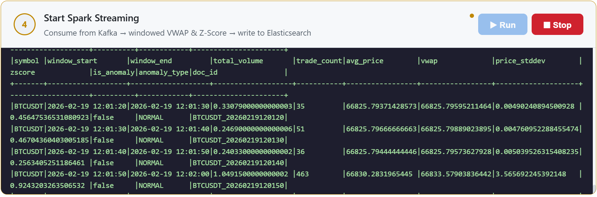
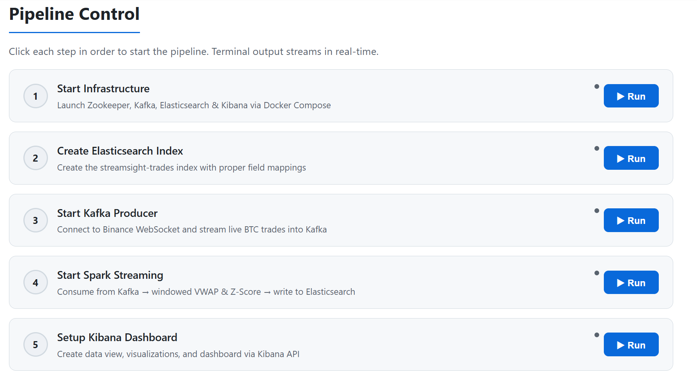
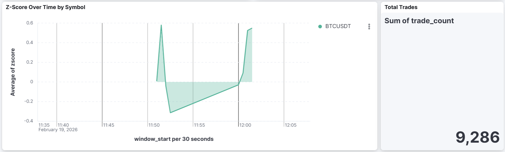
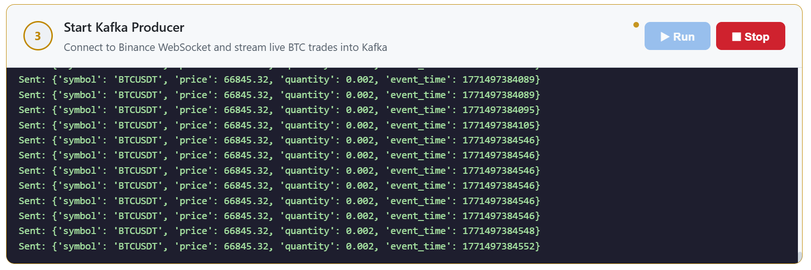
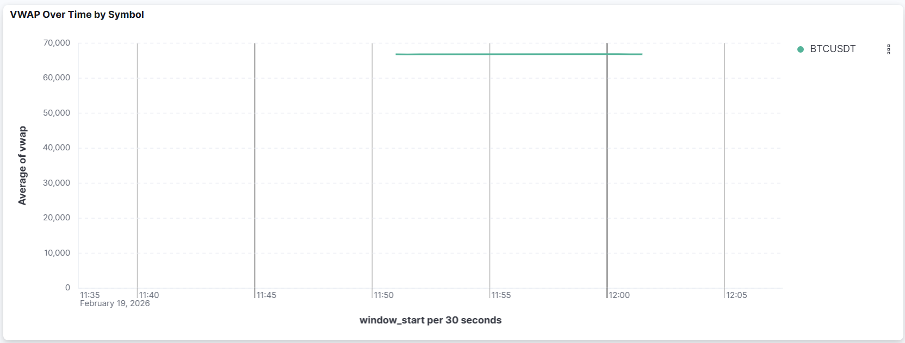

# STREAMSIGHT – Real-Time Crypto Anomaly Detection


An end-to-end **streaming data pipeline** that ingests live Bitcoin trades from Binance, computes volume-weighted prices in time windows with **Spark Structured Streaming**, flags abnormal price moves with a **Z-score**, and visualises everything live in **Kibana**.



**What this project demonstrates**
- Real-time ingestion from a WebSocket API into **Kafka**
- Stateful stream processing in Spark: event-time **tumbling windows**, **watermarks** for late data, aggregations
- A simple, explainable statistical anomaly detector (VWAP + Z-score)
- Indexing into **Elasticsearch** and building **Kibana** dashboards
- Running the whole infrastructure with **Docker Compose**, plus a FastAPI demo app to present and control the pipeline

## Architecture


```
Binance WebSocket ──▶ Python Producer ──▶ Apache Kafka ──▶ Spark Streaming ──▶ Elasticsearch ──▶ Kibana
   (live trades)     (binance_to_kafka.py)  (crypto_trades)  (spark_streaming.py)  (streamsight-trades)    (dashboards)
```

**How it works:** Live BTC/USDT trades are ingested from Binance via WebSocket, published to Kafka, then processed by Spark in tumbling time windows. Each window computes VWAP (Volume-Weighted Average Price) and a Z-score for anomaly detection. Results are written to Elasticsearch and visualized in Kibana.

## Prerequisites

| Tool | Version | Notes |
|------|---------|-------|
| Docker Desktop | Latest | Runs Kafka, Zookeeper, Elasticsearch, Kibana |
| Python | 3.10+ | With pip / venv |
| Apache Spark | 3.5.7 | Pre-built for Hadoop 3 |
| Java | 17 (Eclipse Temurin) | Spark 3.5 does **not** work with Java 18+ |
| Hadoop winutils | 3.3.x | `winutils.exe` + `hadoop.dll` in `C:\hadoop\bin` (Windows only) |

## Quick Start

### 1. Install Python dependencies

```bash
python -m venv venv
.\venv\Scripts\Activate.ps1   # Windows PowerShell
pip install -r requirements.txt
```

### 2. Start infrastructure

```powershell
docker compose up -d
```

Wait ~30-60 seconds for services to be healthy, then verify:

```powershell
docker compose ps
```

### 3. Create Elasticsearch index

```powershell
.\create_es_index.ps1
```

### 4. Clear old checkpoints (if restarting)

```powershell
Remove-Item -Recurse -Force checkpoints -ErrorAction SilentlyContinue
```

### 5. Start the Binance producer (Terminal 1)

```powershell
.\venv\Scripts\Activate.ps1
python binance_to_kafka.py
```

### 6. Start Spark streaming (Terminal 2)

```powershell
$env:JAVA_HOME = "C:\Program Files\Eclipse Adoptium\jdk-17.0.18.8-hotspot"
$env:SPARK_HOME = "C:\spark\spark-3.5.7-bin-hadoop3"
$env:HADOOP_HOME = "C:\hadoop"
$env:PYSPARK_PYTHON = ".\venv\Scripts\python.exe"
$env:PYSPARK_DRIVER_PYTHON = ".\venv\Scripts\python.exe"
$env:PATH = "$env:JAVA_HOME\bin;C:\hadoop\bin;$env:SPARK_HOME\bin;$env:PATH"

spark-submit `
  --packages org.apache.spark:spark-sql-kafka-0-10_2.12:3.5.7,org.elasticsearch:elasticsearch-spark-30_2.12:8.11.4 `
  spark_streaming.py
```

### 7. View results

- **Kibana:** http://localhost:5601
- **ES document count:** `curl http://localhost:9200/streamsight-trades/_count`

> First results appear after ~3-5 minutes (window duration + watermark delay + Spark JIT warm-up).

## Project Structure

```
big-data-pipeline/
├── binance_to_kafka.py      # Binance WebSocket → Kafka producer
├── spark_streaming.py       # Spark Structured Streaming job (VWAP + Z-score)
├── demo_app.py              # FastAPI presentation app: pipeline controls, live logs, embedded Kibana
├── setup_kibana.py          # Creates the Kibana data view and visualisations
├── kibana_dashboard.ndjson  # Exported Kibana dashboard (import via Saved Objects)
├── docker-compose.yml       # Kafka, Zookeeper, Elasticsearch, Kibana
├── create_es_index.ps1      # Elasticsearch index mapping setup
├── requirements.txt         # Python dependencies
├── streamsight_report.tex   # Academic report (LaTeX)
├── pictures/                # Screenshots of every pipeline stage
└── docs/
    ├── PROJECT_EXPLANATION.md   # Detailed project explanation & glossary
    ├── technical_report.md      # Technical architecture report
    ├── kibana_setup.md          # Kibana dashboard setup instructions
    ├── PERSISTENCE_RUNBOOK.md   # Full restart-after-reboot guide
    ├── PRESENTATION_GUIDE.md    # How to demo the project
    └── runbook.txt              # Quick operational reference
```

## Key Metrics

| Metric | Formula | Purpose |
|--------|---------|---------|
| **VWAP** | $\sum(price \times qty) / \sum(qty)$ | Volume-weighted average price per window |
| **Z-Score** | $(VWAP - \mu) / \sigma$ | Deviation from mean — anomaly when \|Z\| > 2.0 |

## Shutdown

```powershell
# Stop producer & Spark: Ctrl+C in each terminal
# Stop Docker services:
docker compose down
```

## Troubleshooting

| Problem | Solution |
|---------|----------|
| Spark crashes with "getSubject is not supported" | Set `$env:JAVA_HOME` to Java 17 (not 18+) |
| Kafka container exits after `docker compose up` | `docker compose restart zookeeper; sleep 10; docker compose restart kafka` |
| No data in Elasticsearch | Ensure both producer and Spark are running; wait 3-5 min for first batch |
| Spark checkpoint errors on restart | Delete `checkpoints/` folder and restart |

## Screenshots

| Spark windowed output | Anomaly detection in Kibana |
|---|---|
|  |  |
| **Live trades in Kafka** | **VWAP over time** |
|  |  |

## About

Built as a university Big Data project by **Mohammed Anes Boucetla** ([github.com/moxaness](https://github.com/moxaness)). The run commands above are written for Windows PowerShell; on Linux/macOS use the equivalent `source venv/bin/activate` and `export` syntax, and skip the `winutils` step.
